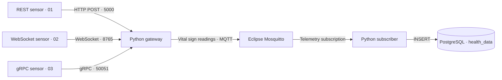

# Health IoT MQTT

A local lab for monitoring vital signs. Three simulated sensors send readings to a shared gateway over REST, WebSocket, and gRPC. The gateway normalizes the readings and publishes them to Mosquitto. An MQTT subscriber writes them to PostgreSQL.

## Architecture



| Input | Contract | Demo sensor |
| --- | --- | --- |
| REST | `POST /api/health-data` on port `5000` | `01` |
| WebSocket | JSON message on port `8765` | `02` |
| gRPC | `HealthService.SendHealthData` on port `50051` | `03` |

The gateway publishes to `data/health/{site}/{floor}/{room}/{sensor_id}/vitals`. Each message contains `patient_id`, `sensor_id`, a timestamp, a location, and vital signs. The [PostgreSQL schema](postgres/init.sql) defines patients, locations, sensors, and readings. Each stored reading must reference a registered sensor.

## Quick start

Install Docker with Compose v2 and BuildKit. From the repository root, run:

```bash
docker compose up -d --build
docker compose ps
```

The simulators start sending readings automatically. After a few seconds, run the query below to check the full pipeline. Expect one row with a positive count for each sensor ID, `01`, `02`, and `03`.

```bash
docker compose exec -T postgres psql -U health_user -d health_data -c \
  "SELECT sensor_id, count(*) FROM medical_records
   WHERE timestamp > now() - interval '1 minute'
   GROUP BY sensor_id ORDER BY sensor_id;"
```

The host can reach the gateway over loopback. Mosquitto and PostgreSQL are accessible on the internal Compose network. Run `docker compose down` to stop the lab and retain the database and broker volumes.

### Builds behind an HTTPS proxy

If your proxy requires a custom CA, use `compose.cloud.yaml` to make the trust bundle available to `pip` during the build.

```bash
docker compose -f compose.yaml -f compose.cloud.yaml up -d --build
```

Set `BUILD_CA_FILE` if your trust bundle is at a path other than the default, `/etc/ssl/certs/ca-certificates.crt`.

## Repository layout

| Path | Contents |
| --- | --- |
| [gateway/](gateway/) | FastAPI, WebSocket and gRPC servers, and MQTT publishing |
| [sensor-rest/](sensor-rest/), [sensor-webSocket/](sensor-webSocket/), [sensor-grpc/](sensor-grpc/) | Vital sign simulators |
| [mqtt-broker/](mqtt-broker/) | Mosquitto configuration for local development |
| [mqtt-subscriber/](mqtt-subscriber/) | MQTT consumer and PostgreSQL writes |
| [postgres/init.sql](postgres/init.sql) | Schema and demo data |

The configuration and example data are intended for a local lab with simulated readings.
